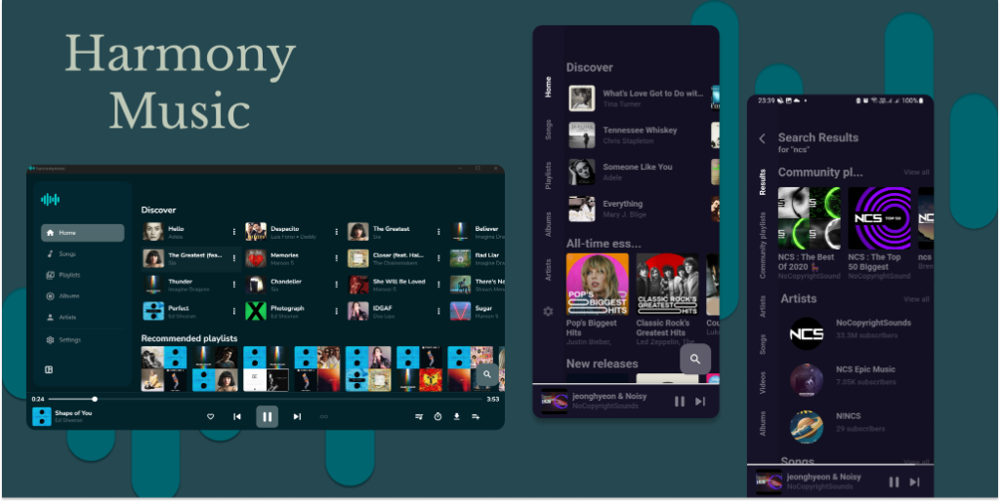

<div align="center">

# 🎵 Harmony Music

**A modern, cross-platform, ad-free music streaming & audio player built with Flutter.**

[](https://github.com/NPP-exe/Harmony-Music/releases/latest)
[](https://npp-exe.github.io/Harmony-Music/)
[](LICENSE)
[](https://hosted.weblate.org/engage/harmony-music/)

<br />

<p align="center">
  
</p>

---

### 🌟 Actively Maintained by [@NPP-exe](https://github.com/NPP-exe)
*Originally created by [@anandnet](https://github.com/anandnet) • Enriched by community contributors*

[**Download Releases**](https://github.com/NPP-exe/Harmony-Music/releases/latest) • [**Launch Web App**](https://npp-exe.github.io/Harmony-Music/) • [**Report an Issue**](https://github.com/NPP-exe/Harmony-Music/issues) • [**Translate on Weblate**](https://hosted.weblate.org/projects/harmony-music/project-translations/)

---

</div>

## 🛠️ Tech Stack & Key Libraries

| Category | Technologies & Libraries |
| :--- | :--- |
| **Languages** |      |
| **Framework & State** |    |
| **Audio Core** | `just_audio` (Mobile & Web) • `media_kit` (Desktop / mpv) • `audio_service` (Background Lifecycle & Auto) |
| **Storage & Data** | `hive` & `hive_flutter` (Lightweight NoSQL Box Store) • Pure Dart ID3v2/MP4/FLAC Parser |
| **APIs & Services** | `youtube_explode_dart` • `Piped API` • `Invidious API` • `LRCLIB API` (Synchronized Lyrics) |

---

## ✨ Features

* **YouTube Music & Piped Streaming**: Play millions of songs, albums, artists, and playlists without advertisements or mandatory login.
* **Instant Share-to-Import**: Import any song, playlist, album, or artist directly by sharing a link from YouTube or YouTube Music.
* **Smart Infinite Radio**: Generate seamless, continuous personalized radio stations from any song or artist.
* **Background Audio & Controls**: Smooth background playback with lock screen media controls, notification actions, and desktop media keys.
* **Song Caching & Downloads**: Automatically cache songs while playing for instant replay, with permanent offline downloading support.
* **Playlist & Bookmark Management**: Create and manage local playlists, bookmark favourite artists and albums, and sync bidirectionally with Piped.
* **Advanced Smart Sorting**: Sort playlists by Order Added (insertion order preservation), custom manual position, title, artist, or duration.
* **Synchronized & Plain Lyrics**: Real-time scrolling karaoke lyrics powered by [LRCLIB](https://lrclib.net) with offline caching and manual search fallback.
* **Pure Dart Local Audio Player**: Embedded metadata extraction for `.mp3`, `.m4a`, `.flac`, `.wav`, `.ogg`, `.opus`, `.aac`, and `.wma` with batch multi-select management.
* **Audio Engine Customization**: Streaming quality selection (Low / High), skip silence, loudness normalization, and native Android equalizer support.
* **Adaptive Glassmorphic UI**: Ambient neon frosted glass styling with dynamic theming that extracts accent colors from album art in real time.
* **Flexible Navigation Layout**: Seamlessly switch between a mobile Bottom Navigation Bar and an expandable desktop Side Navigation Rail.
* **Automotive & Smart Integration**: Native Android Auto support for in-car entertainment and Linux MPRIS desktop player integration.
* **Sleep Timer**: Built-in timer to gracefully stop audio playback automatically.
* **Transactional Backup & Restore**: Safe two-phase journal engine with automatic rollback to ensure zero data corruption.
* **Multilingual Translation**: Fully localized in multiple languages with continuous community translations on Weblate.

---

## 🚀 Platforms & Downloads

| Platform | Format / Package | Source |
| :--- | :--- | :--- |
| **Android** | Universal APK, arm64-v8a, armeabi-v7a, x86_64 | [Releases](https://github.com/NPP-exe/Harmony-Music/releases/latest) |
| **Windows** | Native 64-bit Installer & Portable `.exe` | [Releases](https://github.com/NPP-exe/Harmony-Music/releases/latest) |
| **Linux** | `.deb`, `.rpm`, Portable Binaries | [Releases](https://github.com/NPP-exe/Harmony-Music/releases/latest) |
| **Nix / NixOS** | Flake Package & Developer Shell | `nix run github:NPP-exe/Harmony-Music` |
| **Web** | Live Web App & Offline Local Bundle | [Launch Web App](https://npp-exe.github.io/Harmony-Music/) |
| **macOS / iOS** | Native App Bundles | Flutter Build Toolchain |

### ❄️ Nix (Linux x86_64)

```sh
# Run pinned stable release
nix run github:NPP-exe/Harmony-Music

# Launch reproducible development shell
nix develop github:NPP-exe/Harmony-Music
flutter run
```
*For NixOS and Home Manager configuration details, see [nix/README.md](nix/README.md).*

### 🌐 Web & Local Web Bundle
* **Live Web App**: Access [https://npp-exe.github.io/Harmony-Music/](https://npp-exe.github.io/Harmony-Music/) directly in any modern browser.
* **Offline Local Web Bundle**: Download `harmonymusic-web-local.zip` from workflow artifacts or releases. Run `run-local.bat` (Windows) or `sh run-local.sh` (macOS/Linux) to launch an instant local server at `http://127.0.0.1:8000`.

---

## 🌐 Translations

<div align="center">

[](https://hosted.weblate.org/engage/harmony-music/)

Help bring Harmony Music to your native language on [Weblate](https://hosted.weblate.org/projects/harmony-music/project-translations/)!

</div>

---

## 🛠️ Troubleshooting

* **Playback stops when screen turns off (Android)**: Disable battery optimization in `Settings -> Miscellaneous -> Ignore Battery Optimization`.
* **Missing notification media controls (Android 13+)**: Ensure notification permissions are granted in system app settings.
* **Windows Audio Output**: Ensure the latest Microsoft Visual C++ Redistributable is installed on your machine.

---

## 🤝 Maintainers & Credits

### Maintainer & Lead
* **[@NPP-exe](https://github.com/NPP-exe)** — Maintainer, UI/UX refactoring, multi-platform releases, and feature architecture.

### Original Creator
* **[@anandnet](https://github.com/anandnet)** — Original creator of Harmony Music.

### Community Contributors
Special thanks to our contributors, beta testers, and translators:
* **[@BandhanPramanik](https://github.com/BandhanPramanik)**
* **[@Meralchen](https://github.com/Meralchen)**
* **[@theblackcoderbr](https://github.com/theblackcoderbr)**
* **[@jaxenisr](https://github.com/jaxenisr)**

---

## 📄 License & Disclaimer

* **License**: Free software licensed under the **GNU General Public License v3.0 (GPL-3.0)**. Copies and modifications may not be used for closed-source commercial app stores. See [LICENSE](LICENSE).
* **Disclaimer**: Harmony Music is created for educational purposes. It is not affiliated with, sponsored by, or endorsed by Google, YouTube, or any music service provider. All songs, audio, and trademarks belong to their respective owners.
